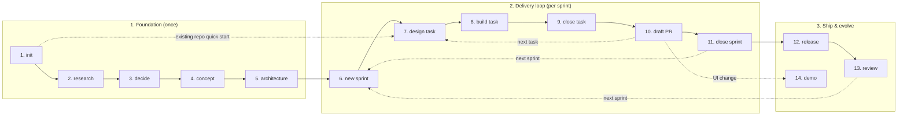

# Gradatim

### From idea to release, no drift

[](LICENSE)
[](docs/guides/install.md#what-you-need)
[](#install)

**One open-source plugin for the entire AI-assisted development cycle.**

Gradatim, Latin for "step by step", takes a software project from its first idea through research, decisions, concept and MVP, architecture, sprints, per-task design and build, draft pull requests, release, periodic reviews, and UI demos. Most AI coding workflows stop at a spec and the code. Gradatim keeps every document true as the work moves, seals completed tasks so their history stays intact, and drops cleanly into existing codebases. It works with Claude Code by default and runs on Codex, GitHub Copilot, OpenCode, and Cursor.

[Install](#install) · [Why Gradatim](#why-gradatim) · [Quick start](#quick-start) · [The cycle](#the-cycle) · [Guardrails](#guardrails-and-project-structure) · [Worked example](#see-it-in-action-shelf)

## Why Gradatim

Building with AI coding agents usually breaks down in two places: you stitch together separate plugins for specs, sprints, reviews, and pull requests, and after a few tasks your architecture, roadmap, and agent docs quietly drift out of sync with the code. Gradatim solves both in one self-contained plugin.

- **One method from idea to release:** Fourteen focused skills take a project through research, decisions, concept and MVP, architecture, sprints, task design and build, code review, draft PRs, runbook-driven releases with rollback, periodic reviews, and UI demos.
- **Anti-drift enforced by scripts:** Closing a task or sprint updates stale documents from the concept down to the tasks, and zero-dependency Node checks verify links, IDs, task statuses, and sealed files. No `npm install` required.
- **Sealed history that stays true:** Once a task or sprint closes, its task file and design are sealed. Later decisions move forward in new records instead of rewriting why past code was built.
- **Built for existing codebases too:** Start on a repo that already has code without moving a single file. Gradatim scans the code once into a cited report, isolates its own docs in `docs/gradatim/` when paths collide, and reaches your first task design in one agreement.
- **Visual HTML artifacts and UI demos:** Generate standalone HTML pages for project overviews, large PR explainers, and ranked review reports with badges, plus paced Playwright walkthrough videos ready to drag into a pull request.
- **You stay in control:** Every writing step drafts first and waits for your explicit agreement. Solo or team workflow, git writes, artifact publishing, and subagent models all defer to your own rules in `AGENTS.md`.

## Install

Requires **Node 20 or later**, **git**, and one of the five supported hosts.

### Claude Code

```bash
claude plugin marketplace add citakilkay/gradatim
claude plugin install gradatim@gradus
```

<details>
<summary><strong>Codex, GitHub Copilot, OpenCode, and Cursor</strong></summary>

**Codex** (start a new session after installing)

```bash
codex plugin marketplace add citakilkay/gradatim
codex plugin add gradatim@gradus
```

**GitHub Copilot CLI** (or in VS Code, run **Chat: Install Plugin from Source** with `https://github.com/citakilkay/gradatim`)

```bash
copilot plugin install citakilkay/gradatim
```

**OpenCode**

```bash
opencode plugin add github:citakilkay/gradatim
```

**Cursor** (clone into your local plugins folder, then reload the window)

```bash
git clone https://github.com/citakilkay/gradatim ~/.cursor/plugins/local/gradatim
```

</details>

See [the install guide](docs/guides/install.md) for updates, removal, [calling a skill on each host](docs/guides/install.md#calling-a-skill), subagent model routing, and [when something goes wrong](docs/guides/install.md#when-something-goes-wrong).

## Quick start

Run `/gradatim:hello` ([guide](docs/guides/hello.md)) to verify your install, or `/gradatim:method` ([guide](docs/guides/method.md)) at any point to see where your project stands and which step comes next.

```text
/gradatim:init-project Build an offline-first book tracker that fills in titles by ISBN
# Sets up git and AGENTS.md, shows the cycle, and proposes research topics

/gradatim:research-topics
# Writes cited reports with risks and trade-offs; decides nothing

/gradatim:decide-direction
# Asks questions until you both agree, records decisions, and runs the doc sync
```

You can also ask for any step in your own words, such as "research these topics": a step that writes asks before it writes. On the other hosts, call skills by name as [the install guide](docs/guides/install.md#calling-a-skill) shows.

### New project or existing codebase

Both start with the same command: `/gradatim:init-project`.

| Starting from | What Gradatim does | Path to your first build |
|---|---|---|
| **A new idea** | Sets up git and `AGENTS.md` with your idea, solo or team workflow, and the document order, then proposes topics to research. | Full cycle: `research` → `decide` → `concept` → `architecture` → `new sprint` → `design task`. |
| **An existing codebase** | Keeps every existing file untouched. Where your files hold Gradatim's paths, Gradatim stores its documents in `docs/gradatim/`. Choose the quick start or the full cycle. | Quick start: one read-only scan of your code (runs nothing, opens no secret files) and one agreement reach `design task`. |

## The cycle

Fourteen steps in three phases, each run by its own skill.



- **The task loop:** design task, build task, close task, and draft PR where a pull request is due, one task at a time, in the order of the open sprint's board.
- **The sprint loop:** new sprint, the task loops, and close sprint; then release when there is something to ship, and review every two or three sprints.
- **Anytime steps:** `research`, `decide` (a change of direction), `concept` (a changed plan), `architecture` (a changed stack), `release`, and `demo` (once the project has a UI).

Each skill's guide says when to use it, how to call it, what it reads and writes, and what comes next.

<!-- generated by npm run guides from cycle.md: edit that, not this block -->

| # | Step | Skill | What it does |
|---|---|---|---|
| 1 | init | [`init-project`](docs/guides/init-project.md) | Sets up the project's folder: git, and `AGENTS.md` with the idea, who works on it and the order of the documents. Presents the cycle, or runs the quick start |
| 2 | research | [`research-topics`](docs/guides/research-topics.md) | Researches the topics the user picks, in cited reports that mark the risks and trade-offs. Decides nothing |
| 3 | decide | [`decide-direction`](docs/guides/decide-direction.md) | Asks the user questions until you both agree, records the decisions, then runs the sync |
| 4 | concept | [`write-concept`](docs/guides/write-concept.md) | Writes the concept, the MVP, the roadmap and the phases, and the overview artifact |
| 5 | architecture | [`write-architecture`](docs/guides/write-architecture.md) | Agrees the stack and the structure with the user and records them. Writes the architecture with its deployment view, the runbook and the agent docs |
| 6 | new sprint | [`new-sprint`](docs/guides/new-sprint.md) | Plans the next sprint's tasks, or adds a task to the open sprint |
| 7 | design task | [`design-task`](docs/guides/design-task.md) | Brainstorms a task with the user and writes its design |
| 8 | build task | [`build-task`](docs/guides/build-task.md) | Builds the task and makes sure it works. A problem that needs thought becomes an issue |
| 9 | close task | [`close-task`](docs/guides/close-task.md) | Checks the criteria, reviews the code, updates what the task made stale, and seals the task |
| 10 | draft PR | [`draft-pr`](docs/guides/draft-pr.md) | Opens a draft pull request, with an explainer when it is large |
| 11 | close sprint | [`close-sprint`](docs/guides/close-sprint.md) | Checks the sprint's critical changes, defers what is left, brings the main documents in line, and seals the sprint |
| 12 | release | [`ship-release`](docs/guides/ship-release.md) | Ships by the runbook, checks the release and records it. Rolls back a release that fails its check |
| 13 | review | [`review-project`](docs/guides/review-project.md) | Ranks improvements to the architecture, the UX and the features in an artifact, with badges. The user's picks become stories |
| 14 | demo | [`record-demo`](docs/guides/record-demo.md) | Records a walkthrough of the project's UI |

<!-- end of the generated block -->

## Guardrails and project structure

### What every step shares

- **Names the next step, never jumps ahead:** Every step reads your project's documents to propose the next step and skill, and starts it only at your word.
- **Nothing finalizes without your yes:** Every writing step (`init` aside) shows its draft and asks for your agreement before marking anything final.
- **Handles mid-task changes in stride:** A change that comes up during task design, build, or close is taken in the same run with a dated note under the record it changes. A direction pivot goes to `decide`, and a stack or module change goes to `architecture`.
- **Your rules win:** Any rule you set in `AGENTS.md` or state in chat (git writes, artifact publishing, subagent models) overrides Gradatim's defaults. Gradatim never writes a `CLAUDE.md` and never bypasses a project hook.

### Top-down document hierarchy

Documents flow top-down: **Concept → MVP and phases → Architecture → Sprints → Tasks**. The guides call this layout "the map": [the method's document map](skills/method/references/documents.md) names every document, its path, and the one step that creates it.

```text
your-project/
├── AGENTS.md                         # Idea, solo or team mode, your rules, document order
└── docs/                             # Or docs/gradatim/ if your repo already uses docs/
    ├── research/                     # Cited reports with risks and trade-offs
    ├── decisions/                    # Numbered decision records (D1, D2, ...)
    ├── MAIN_CONCEPT.md               # Living product concept
    ├── MVP.md, ROADMAP.md, PHASE-*.md
    ├── ARCHITECTURE.md, RUNBOOK.md   # Modules, stack, deployment and rollback runbook
    ├── RELEASES.md                   # Append-only release and rollback log
    ├── agents/                       # Modular topic guides for agents
    ├── sprints/sprint-1/             # Ordered board and module-coded tasks (OPS-1, ...)
    ├── plans/                        # Per-task design docs (sealed when closed)
    ├── artifacts/                    # Standalone HTML overview, PR explainers, reviews
    └── demos/                        # Playwright walkthrough scripts (.webm git-ignored)
```

## See it in action: Shelf

[The worked example](docs/guides/example.md) walks **Shelf**, a made-up offline-first book tracker, through every step of the cycle, with each step's real output kept in this repository:

- **Plan and visual overview:** [Concept](tests/sample/after-concept/docs/MAIN_CONCEPT.md), [MVP](tests/sample/after-concept/docs/MVP.md), and the generated [overview HTML artifact](tests/sample/after-concept/docs/artifacts/01-overview.html).
- **Architecture and sprint execution:** [Architecture](tests/sample/after-architecture/docs/ARCHITECTURE.md), [Sprint 1 board](tests/sample/after-new-sprint/docs/sprints/sprint-1/README.md), and [OPS-1 closed and sealed](tests/sample/after-close-task/docs/sprints/sprint-1/OPS-1-project-setup.md).
- **PR explainer, periodic review, and UI demo:** [PR explainer artifact](tests/sample/after-draft-pr/docs/artifacts/02-pr-project-setup.html), [ranked Sprint 2 review report](tests/sample/after-review/docs/artifacts/02-review-sprint-2.html), and [Playwright walkthrough script](tests/sample/after-demo/docs/demos/2026-11-14-add-by-isbn.mjs).

## Contributing

To report a problem or propose a change, see [CONTRIBUTING.md](CONTRIBUTING.md). To report a vulnerability, see [SECURITY.md](SECURITY.md).

## License

MIT, as [LICENSE](LICENSE) says.
